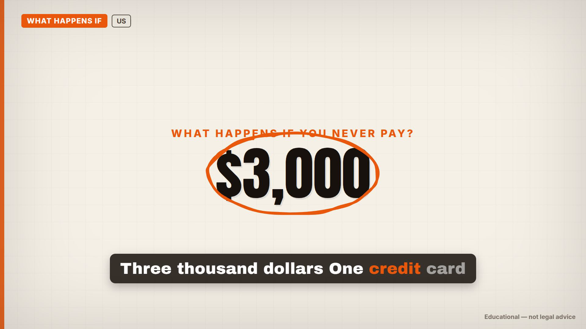

# Legally Rich

Evidence-grounded, code-drawn legal explainer videos — written as data, narrated by
Edge-TTS, animated with [Rough.js](https://roughjs.com/) inside
[Remotion](https://www.remotion.dev/), and rendered headless on CI.

Every episode is one hand-written, fact-checked `case.json`. The pipeline turns it
into a finished MP4 with synced captions, a running money ledger, and **real legal
documents zoomed and highlighted on screen**.



## How it works

```
episodes/<id>/case.json            # the episode: scenes + narration + evidence + beats
      │
      ├─ scripts/tts.py            # edge-tts "Brian" → per-scene mp3 + word timings
      ├─ scripts/fetch_evidence.py # Playwright → real statute/filing PNGs + highlight boxes
      ├─ scripts/build_manifest.mjs# measures audio, anchors each visual beat to its word
      │
      └─ src/ (Remotion + Rough.js)# renders scenes, HUD, captions, document camera
                 │
                 └─ out/<id>.mp4
```

Key ideas:

- **Narration is the clock.** Edge-TTS returns word-level timings. Visual *beats*
  in `case.json` reference a word (`"anchor": "within thirty days"`) and the build
  resolves it to an exact timestamp, so animations fire on the spoken word.
- **Evidence is real and committed.** `fetch_evidence.py` screenshots the actual
  statute/agency page and records the highlight rectangle. The PNGs are committed, so
  the render is reproducible on CI without re-hitting court websites. A clean
  rendered-card fallback is used if a page can't be captured.
- **Hand-drawn, in code.** Shapes are generated with the Rough.js *generator* (pure
  SVG paths — deterministic for frame-by-frame rendering), with a draw-on animation
  and a slow seed "boil" so the lines wiggle like real hand-drawn animation. No AI
  imagery, no stock footage, no courtroom clips.

## Quick start

```bash
npm install
pip install edge-tts
# optional, only to (re)capture evidence PNGs:
pip install playwright && python -m playwright install chromium

# build one episode end to end
node scripts/build.mjs episodes/ep01-credit-card

# iterate on the animation in the browser
npm run preview
```

Render a slice while iterating: `node scripts/build.mjs episodes/ep01-credit-card --frames=0-300`.

## Authoring an episode

Write `episodes/<id>/case.json` (see `src/schema.ts` for the full shape):

- `scenes[]` — each has a `kind` (`cold-open`, `step`, `document`, `ledger`,
  `jurisdiction`, `outro`, …), the `narration` to speak, and optional `headline`,
  `citation`, `ledger`, `ledgerState`, and `beats`.
- `evidence[]` — each has a `url`, the `find` phrases to highlight, and a `fallback`
  card. Run `npm run evidence -- episodes/<id>` to capture, then commit the PNGs.
- `sources[]` — the citation list appended to the description.

House rules (carried from the channel plan): filed facts and statutes only;
descriptive framing ("how the system works"), never advice; a source card for every
figure; "educational, not legal advice" on every upload.

## CI

`.github/workflows/render.yml` renders the episode on every push to `case.json`,
`src/`, or `scripts/`, and uploads the MP4 as an artifact. A manual
`workflow_dispatch` run can also re-capture evidence PNGs.

> This video is educational and not legal or financial advice.
